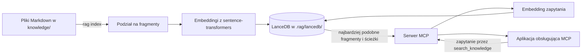

# Lokalny RAG dla aplikacji obsługujących MCP

[](https://github.com/01miru/simple-rag/actions/workflows/tests.yml)

Projekt wyszukuje informacje w polskich i wielojęzycznych plikach Markdown za pomocą wyszukiwania semantycznego. Embeddingi i indeks tworzy lokalnie. Serwer MCP udostępnia wyszukiwanie Codexowi oraz innym aplikacjom i agentom obsługującym MCP.

Polecenia `rag index` i `rag serve` uruchamia się w terminalu. Do indeksowania potrzebny jest katalog `knowledge/`. Narzędzie MCP `search_knowledge` zwraca fragmenty dokumentów wraz ze źródłem i oceną podobieństwa. Źródłem jest ścieżka pliku względem katalogu projektu, więc fragmenty tego samego pliku mają ten sam identyfikator. Podobieństwo cosinusowe ma wartość od -1 do 1; im jest większe, tym wynik jest bardziej podobny do zapytania. Sposób konfiguracji klienta MCP znajdziesz w dokumentacji używanej aplikacji.

## Jak to działa



## Pakiety i baza wektorowa

- LanceDB przechowuje wektory i fragmenty dokumentów w `.rag/lancedb/`, a stan indeksowania plików w `.rag/manifest.json`.
- sentence-transformers tworzy embeddingi za pomocą modelu `paraphrase-multilingual-MiniLM-L12-v2` z Hugging Face.
- PyTorch uruchamia model na CPU albo na karcie NVIDIA obsługującej CUDA.
- FastMCP udostępnia wyszukiwanie przez MCP, korzystając z transportu `stdio`.

Pakiety zainstalujesz poleceniem `uv sync`. Przy pierwszym użyciu model zostanie pobrany z Hugging Face. Potrzebujesz do tego dostępu do internetu i wolnego miejsca na dysku. Jeśli masz kartę NVIDIA z CUDA, PyTorch jej użyje. W przeciwnym razie model działa na CPU.

## Instalacja i indeksowanie

Projekt wymaga Python 3.13 i [uv](https://docs.astral.sh/uv/). W katalogu projektu uruchom:

```sh
uv sync
# Umieść dokumenty .md w knowledge/ (również w podkatalogach).
uv run rag index
```

Po dodaniu, zmianie lub usunięciu dokumentów uruchom ponownie `uv run rag index`. Polecenie przetwarza treść partiami: aktualizuje zmienione pliki w indeksie `.rag/` i usuwa z niego brakujące dokumenty. Pliki muszą być zapisane w UTF-8. Po aktualizacji ze starszej wersji pierwsze uruchomienie przebuduje indeks.

## Testy jakości wyszukiwania

Szybkie testy uruchom poleceniem `uv run pytest`. Osobny test jakości korzysta z rzeczywistego modelu: indeksuje sześć przykładowych dokumentów i sprawdza zapytania po polsku i angielsku. Uruchomisz go tak:

```sh
RAG_QUALITY_TEST=1 uv run pytest -q tests/test_retrieval_quality.py
```

Test wymaga co najmniej 5 trafień na 6 zapytań w pierwszych trzech wynikach (Recall@3). Średnia odwrotność pozycji właściwego wyniku (MRR@3) musi wynosić co najmniej 0,65. Przy pierwszym uruchomieniu model może zostać pobrany. Ten niewielki zestaw pomaga wykryć regresje, ale nie mierzy jakości wyszukiwania we własnych dokumentach.

## Podłączenie do Codexa

Podłącz Codexa do serwera MCP poniższym poleceniem. Zastąp przykładowe ścieżki bezwzględną ścieżką do projektu:

```sh
codex mcp add lokalna-wiedza -- /ABSOLUTNA/SCIEZKA/DO/rag/.venv/bin/rag serve --directory /ABSOLUTNA/SCIEZKA/DO/rag
```

Sprawdź konfigurację poleceniem `codex mcp list`, a potem uruchom ponownie sesję Codexa. Możesz poprosić na przykład: „Wyszukaj w lokalnej wiedzy informacje o … i podaj źródła”. Codex korzysta wtedy z fragmentów dokumentów i ścieżek zwróconych przez `search_knowledge`. Więcej informacji o konfiguracji MCP znajdziesz w [dokumentacji OpenAI](https://developers.openai.com/codex/mcp/).

Do indeksu i modelu nie potrzebujesz klucza API. Korzystanie z Codexa podlega ustawieniom wybranej usługi Codex.
