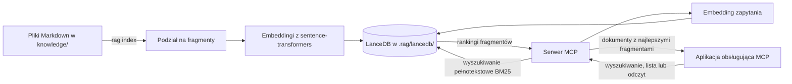

# Lokalny RAG dla aplikacji obsługujących MCP

[](https://github.com/01miru/simple-rag/actions/workflows/tests.yml)

Projekt wyszukuje informacje w polskich i wielojęzycznych plikach Markdown. Indeks i embeddingi powstają lokalnie. Serwer MCP udostępnia dokumenty klientom obsługującym MCP.

Polecenia `rag index` i `rag serve` uruchomisz w terminalu. Indeksowanie wymaga katalogu `knowledge/`. Serwer udostępnia trzy narzędzia: `search_knowledge` wyszukuje dokumenty i zwraca ich najlepiej pasujące fragmenty, `list_documents` pokazuje zaindeksowane pliki, a `get_document` pobiera wskazany zakres linii. Każde źródło ma ścieżkę względem katalogu projektu. Konfigurację klienta MCP opisuje dokumentacja danej aplikacji.

## Jak to działa



Wyniki są grupowane po dokumencie: jeden wynik to jeden plik z kilkoma najlepiej pasującymi fragmentami. Dzięki temu długi dokument nie zajmuje wszystkich miejsc na liście, a `limit` określa liczbę znalezionych dokumentów. O pozycji dokumentu decyduje jego najlepszy fragment. Jeśli fragmenty jednego dokumentu wypełniają listę kandydatów, wyszukiwanie pobiera kolejne fragmenty z pozostałych dokumentów, aż zbierze ich `limit` albo wyczerpie indeks.

Domyślne wyszukiwanie hybrydowe łączy ranking semantyczny z rankingiem pełnotekstowym BM25 za pomocą ważonego Reciprocal Rank Fusion (RRF). Dla każdego dokumentu sumuje `0,8 / (1 + pozycja)` w rankingu semantycznym i `0,2 / (1 + pozycja)` w rankingu BM25. Pozycje dokumentów liczone są od 1. Jeśli dokument nie trafił do jednego z rankingów, wynik z tego rankingu nie jest doliczany. Fragmenty wewnątrz dokumentu są porządkowane w ten sam sposób. Wagi i stała RRF są zapisane w `src/rag/search.py`; nie można ich zmienić przez narzędzie MCP ani CLI.

BM25 może pomóc znaleźć występujące w dokumentach nazwy własne, kody i słowa z dokładnych fraz, które wyszukiwanie semantyczne mogłoby pominąć. Hybryda nie gwarantuje jednak lepszych wyników dla każdego zapytania ani dokładnego dopasowania całej frazy. Warto sprawdzić jej jakość na własnych dokumentach i pytaniach.

## Pakiety i baza wektorowa

- LanceDB przechowuje wektory i fragmenty dokumentów w `.rag/lancedb/`, a stan indeksowania plików w `.rag/manifest.json`.
- sentence-transformers tworzy embeddingi za pomocą modelu `intfloat/multilingual-e5-large` z Hugging Face.
- PyTorch uruchamia model na CPU albo na karcie NVIDIA obsługującej CUDA.
- FastMCP udostępnia wyszukiwanie przez MCP, korzystając z transportu `stdio`.

Zainstaluj pakiety poleceniem `uv sync`. Przy pierwszym użyciu model pobierze się z Hugging Face, co wymaga dostępu do internetu i miejsca na dysku. PyTorch użyje karty NVIDIA z CUDA, jeśli jest dostępna; w pozostałych przypadkach model działa na CPU.

## Instalacja i indeksowanie

Potrzebujesz Python 3.13 i [uv](https://docs.astral.sh/uv/). W katalogu projektu uruchom:

```sh
uv sync
# Umieść dokumenty .md w knowledge/ (również w podkatalogach).
uv run rag index
```

Po dodaniu, zmianie lub usunięciu dokumentów ponownie uruchom `uv run rag index`. Polecenie aktualizuje zmienione pliki i usuwa z indeksu `.rag/` te, których już nie ma. Dokumenty zapisuj w UTF-8. Po zmianie modelu uruchom ponownie `uv run rag index`, aby przebudować indeks przed wyszukiwaniem.

Indeks dzieli dokumenty według nagłówków i bloków Markdown, pilnując limitu tokenów modelu embeddingowego. Model otrzymuje ścieżkę nagłówków razem z treścią fragmentu; długie ścieżki są skracane, aby zostawić miejsce na treść. Wyniki zawierają oryginalną treść, pełną ścieżkę nagłówków sekcji i zakres linii fragmentu w pliku źródłowym. Bloki kodu i tabele mieszczące się w limicie pozostają w całości. Dłuższe bloki są dzielone.

## Narzędzia MCP

Użyj `search_knowledge`, aby znaleźć dokumenty związane z pytaniem. `list_documents` pokazuje pliki w indeksie, a `get_document` pobiera wybrany zakres linii do sprawdzenia.

### `search_knowledge`

```text
search_knowledge(query, limit=5, path_prefix=null, mode="hybrid", fragments_per_document=2)
```

- `query` — niepuste pytanie lub fraza.
- `limit` — liczba dokumentów, od 1 do 50; domyślnie 5.
- `path_prefix` — opcjonalna ścieżka względna względem katalogu projektu. Pełna ścieżka pliku dopasowuje ten plik, a ścieżka katalogu dopasowuje jego zawartość z granicą segmentu. Na przykład `knowledge/projekt/` nie obejmuje `knowledge/projekt-inny/`.
- `mode` — `hybrid` (domyślny), `semantic` lub `keyword`.
- `fragments_per_document` — liczba fragmentów zwracanych dla każdego dokumentu, od 1 do 10; domyślnie 2.

Wynik to JSON z listą `results`, w której każda pozycja opisuje jeden dokument:

```json
{
  "results": [
    {
      "source": "knowledge/podróże/delegacje.md",
      "score": 0.5,
      "matched_by": ["semantic", "keyword"],
      "fragments": [
        {
          "section": "Delegacje > Zwrot kosztów",
          "start_line": 41,
          "end_line": 58,
          "content": "…",
          "semantic_similarity": 0.87,
          "matched_by": ["semantic", "keyword"]
        }
      ]
    }
  ]
}
```

Pole `score` dokumentu zależy od trybu: `hybrid` zwraca wynik RRF, `semantic` podobieństwo cosinusowe najlepszego fragmentu, a `keyword` jego wynik BM25. Wartości z różnych trybów nie są porównywalne. Fragmenty są uporządkowane od najlepiej pasującego. Pola `start_line` i `end_line` podają zakres linii fragmentu w pliku, więc możesz przekazać `start_line` do `get_document` i przeczytać jego otoczenie. Podobieństwo cosinusowe mieści się w zakresie od -1 do 1; im wyższa wartość, tym bardziej fragment przypomina zapytanie. Pole `semantic_similarity` ma wartość `null`, gdy fragment nie występuje w rankingu semantycznym. W razie błędu odpowiedź zawiera pole `error`. Po aktualizacji uruchom `rag index`, aby przebudować indeks.

Przykłady: `search_knowledge("zasady zwrotu kosztów", limit=8, path_prefix="knowledge/podróże/")` znajdzie do ośmiu dokumentów w katalogu. `search_knowledge("zwrot kosztów noclegu", limit=1, path_prefix="knowledge/podróże/delegacje.md", fragments_per_document=10)` przeszuka jeden dokument i zwróci do dziesięciu jego fragmentów.

### `list_documents`

```text
list_documents(path_prefix=null, limit=100, offset=0)
```

Zwraca ścieżki plików z manifestu indeksu oraz pola `total`, `limit`, `offset` i `has_more`. Limit wynosi od 1 do 500, a offset nie może być ujemny. Lista jest sortowana po ścieżce. Aby pobrać następną stronę, dodaj limit do offsetu.

### `get_document`

```text
get_document(path, start_line=1, max_lines=200)
```

Odczytuje plik `.md` z katalogu `knowledge/`, o ile plik znajduje się w indeksie i nie zmienił się od ostatniego indeksowania. Numeracja linii zaczyna się od 1, a `max_lines` może wynosić od 1 do 500. Odpowiedź podaje ścieżkę, zakres i łączną liczbę linii, treść oraz `has_more`. Po zmianie pliku narzędzie poprosi o ponowne uruchomienie `rag index`.

Możesz poprosić asystenta: „Znajdź dokumenty o zasadach zwrotów”, „Porównaj dwie polityki i wskaż różnice” albo „Podaj wnioski z tych dokumentów wraz ze źródłami”. Wyszukiwanie wybiera dokumenty podobne do zapytania i może pominąć część pasujących. Gdy chcesz wyciągnąć wnioski z wielu dokumentów, użyj wyższego limitu i kilku sformułowań pytania, a wymagane źródła sprawdź przez `list_documents` i `get_document`.

## Testy jakości wyszukiwania

Szybki zestaw testów jednostkowych i integracyjnych używa atrap modelu. Uruchomisz go poleceniem `uv run pytest`. Opcjonalny test jakości korzysta z prawdziwego modelu, indeksuje sześć przykładowych dokumentów i sprawdza pytania po polsku oraz angielsku. Włączysz go tak:

```sh
RAG_QUALITY_TEST=1 uv run pytest -q tests/test_retrieval_quality.py
```

Test wymaga, by właściwy dokument znalazł się w pierwszej trójce dla co najmniej pięciu z sześciu pytań (Recall@3). Średnia odwrotność pozycji właściwego wyniku (MRR@3) musi wynieść co najmniej 0,65. Pierwsze uruchomienie może pobrać model. Dodatkowe 30 parafraz sprawdza Recall@5 co najmniej 0,8 i MRR@5 co najmniej 0,65. Zestaw wykrywa regresje, ale nie ocenia jakości wyszukiwania w Twoich dokumentach.

Osobny test `tests/test_similar_documents.py` indeksuje 30 podobnych protokołów serwisowych, z których pięć pasuje do każdego pytania. Sprawdza, jaka część oczekiwanych dokumentów trafia do wyników. Wyniki pomiarów opisuje `tests/baseline.md`.

Szybkie testy sprawdzają też podział długiego fikcyjnego dokumentu Markdown, w tym limit tokenów, treść i nagłówki. Opcjonalny test jakości indeksuje ten dokument osobno i sprawdza, czy odpowiednie fragmenty z początku, środka i końca pojawiają się w pierwszej trójce wyników. Nie ocenia odpowiedzi generowanych przez LLM.

## Korzystanie w VS Code

Plik `.mcp.json` w katalogu głównym projektu zawiera konfigurację serwera MCP. Po otwarciu katalogu projektu w VS Code sesja Copilot może automatycznie korzystać z tej konfiguracji. Najpierw zainstaluj zależności i utwórz indeks zgodnie z instrukcją powyżej. Polecenie `uv` musi być dostępne w środowisku VS Code.

Do indeksu i modelu nie potrzebujesz klucza API. Więcej informacji o konfiguracji serwerów znajdziesz w [dokumentacji VS Code](https://code.visualstudio.com/docs/agents/reference/mcp-configuration).

## Agent lokalnej wiedzy

W pliku [knowledge-agent/instructions.md](knowledge-agent/instructions.md) znajdziesz instrukcje dla asystenta, który wyszukuje informacje w lokalnych dokumentach, sprawdza ich kontekst i podaje źródła. Możesz użyć ich w różnych aplikacjach. Sam plik nie uruchamia serwera MCP: najpierw zainstaluj zależności, zaindeksuj dokumenty i skonfiguruj serwer `lokalna-wiedza` w wybranej aplikacji.

- VS Code i GitHub Copilot: skopiuj plik do `.github/agents/lokalna-wiedza.agent.md` w katalogu projektu. Następnie wybierz agenta w czacie i zadaj pytanie. Więcej o formacie i lokalizacji plików znajdziesz w [dokumentacji agentów VS Code](https://code.visualstudio.com/docs/agents/reference/custom-agent-file-reference).
- Claude Code: skonfiguruj serwer MCP, a następnie utwórz agenta poleceniem `/agents` i umieść treść pliku w jego instrukcjach. Więcej informacji znajdziesz w [dokumentacji subagentów](https://code.claude.com/docs/en/sub-agents).
- Codex: skonfiguruj serwer MCP, a następnie poproś w rozmowie: „Przeczytaj `knowledge-agent/instructions.md` i odpowiedz zgodnie z tymi instrukcjami na pytanie: …”. Możesz też dodać wybrane instrukcje do istniejącego `AGENTS.md`. Będą wtedy instrukcjami projektu, a nie osobnym agentem. Zobacz [instrukcje AGENTS.md](https://developers.openai.com/codex/guides/agents-md/).
- Inny klient MCP: jeśli aplikacja na to pozwala, wklej treść pliku jako instrukcję systemową lub instrukcję własnego agenta. Możesz też wkleić ją na początku rozmowy.

Nie każda aplikacja korzysta automatycznie z projektowego pliku `.mcp.json`. Jeśli klient uruchamia serwer z innego katalogu roboczego, zastąp w jego konfiguracji oba wystąpienia `.` po `--project` i `--directory` bezwzględną ścieżką do tego projektu. Sprawdź też, czy aplikacja ma dostęp do `uv`.

### Ocena własnego korpusu

Przygotuj poza repozytorium plik JSON z pytaniami i oczekiwanymi źródłami, na przykład:

```json
[
  {"query": "przykładowe pytanie", "source": "knowledge/dokument.md", "category": "lexical", "content_contains": "oczekiwany fragment"}
]
```

Pola `query` i `category` są wymagane. Oczekiwany dokument podaj w polu `source`, a gdy do pytania pasuje kilka dokumentów, podaj ich listę w polu `sources`:

```json
[
  {"query": "pytanie o temat", "sources": ["knowledge/a.md", "knowledge/b.md", "knowledge/c.md"], "category": "topic"}
]
```

W polu `content_contains` możesz wskazać fragment dłuższego dokumentu; pole wymaga jednego źródła, a dokument liczy się jako znaleziony, gdy tekst występuje w jednym z pięciu jego najlepszych fragmentów. Kategoria `all` jest zarezerwowana dla wyników zbiorczych. Po zaindeksowaniu dokumentów uruchom:

```sh
uv run python -m rag.evaluate /ścieżka/do/projektu /ścieżka/do/pytań.json
```

Raport JSON podaje liczbę pytań, Recall i MRR dla pierwszych 3, 5 i 10 dokumentów oraz medianę czasu dla każdego trybu i kategorii. Recall to odsetek oczekiwanych dokumentów znalezionych wśród pierwszych `k` wyników; gdy oczekiwanych dokumentów jest więcej niż `k`, dzielnikiem jest `k`. MRR to odwrotność pozycji pierwszego oczekiwanego dokumentu. Pomiar obejmuje całą funkcję wyszukiwania po rozgrzaniu modelu. Raport nie zawiera pytań ani treści dokumentów. Użyj pytań niezależnych od zestawu do strojenia. Jeśli zawierają dane prywatne, pozostaw je poza repozytorium.
