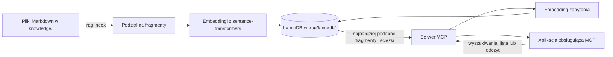

# Lokalny RAG dla aplikacji obsługujących MCP

[](https://github.com/01miru/simple-rag/actions/workflows/tests.yml)

Projekt wyszukuje informacje w polskich i wielojęzycznych plikach Markdown. Indeks i embeddingi powstają lokalnie. Serwer MCP udostępnia dokumenty klientom obsługującym MCP.

Polecenia `rag index` i `rag serve` uruchomisz w terminalu. Indeksowanie wymaga katalogu `knowledge/`. Serwer udostępnia trzy narzędzia: `search_knowledge` wyszukuje fragmenty, `list_documents` pokazuje zaindeksowane pliki, a `get_document` pobiera wskazany zakres linii. Każde źródło ma ścieżkę względem katalogu projektu. Podobieństwo cosinusowe mieści się w zakresie od -1 do 1. Im wyższa wartość, tym bardziej fragment przypomina zapytanie. Konfigurację klienta MCP opisuje dokumentacja danej aplikacji.

## Jak to działa



## Pakiety i baza wektorowa

- LanceDB przechowuje wektory i fragmenty dokumentów w `.rag/lancedb/`, a stan indeksowania plików w `.rag/manifest.json`.
- sentence-transformers tworzy embeddingi za pomocą modelu `paraphrase-multilingual-MiniLM-L12-v2` z Hugging Face.
- PyTorch uruchamia model na CPU albo na karcie NVIDIA obsługującej CUDA.
- FastMCP udostępnia wyszukiwanie przez MCP, korzystając z transportu `stdio`.

Zainstaluj pakiety poleceniem `uv sync`. Przy pierwszym użyciu model pobierze się z Hugging Face, co wymaga dostępu do internetu i miejsca na dysku. PyTorch użyje karty NVIDIA z CUDA, jeśli jest dostępna; w pozostałych przypadkach model działa na CPU.

## Instalacja i indeksowanie

Potrzebujesz Python 3.13 i [uv](https://docs.astral.sh/uv/). W katalogu projektu uruchom:

```sh
uv sync
# Umieść dokumenty .md w knowledge/ (również w podkatalogach).
uv run rag index
```

Po dodaniu, zmianie lub usunięciu dokumentów ponownie uruchom `uv run rag index`. Polecenie aktualizuje zmienione pliki i usuwa z indeksu `.rag/` te, których już nie ma. Dokumenty zapisuj w UTF-8. Pierwsze indeksowanie po aktualizacji ze starszej wersji przebuduje indeks.

Indeks dzieli dokumenty według nagłówków i bloków Markdown, pilnując limitu tokenów modelu embeddingowego. Model otrzymuje ścieżkę nagłówków razem z treścią fragmentu; długie ścieżki są skracane, aby zostawić miejsce na treść. Wyniki zawierają oryginalną treść i pełną ścieżkę nagłówków sekcji. Bloki kodu i tabele mieszczące się w limicie pozostają w całości. Dłuższe bloki są dzielone.

## Narzędzia MCP

Użyj `search_knowledge`, aby znaleźć dokumenty związane z pytaniem. `list_documents` pokazuje pliki w indeksie, a `get_document` pobiera wybrany fragment do sprawdzenia.

### `search_knowledge`

```text
search_knowledge(query, limit=5, path_prefix=null)
```

- `query` — niepuste pytanie lub fraza.
- `limit` — liczba fragmentów, od 1 do 50; domyślnie 5.
- `path_prefix` — opcjonalna ścieżka względna względem katalogu projektu. Pełna ścieżka pliku dopasowuje ten plik, a ścieżka katalogu dopasowuje jego zawartość z granicą segmentu. Na przykład `knowledge/projekt/` nie obejmuje `knowledge/projekt-inny/`.

Wynik zawiera źródło, sekcję, podobieństwo i treść. Przykład: `search_knowledge("zasady zwrotu kosztów", limit=8, path_prefix="knowledge/podróże/")`.

### `list_documents`

```text
list_documents(path_prefix=null, limit=100, offset=0)
```

Zwraca ścieżki plików z manifestu indeksu oraz pola `total`, `limit`, `offset` i `has_more`. Limit wynosi od 1 do 500, a offset nie może być ujemny. Lista jest sortowana po ścieżce. Aby pobrać następną stronę, dodaj limit do offsetu.

### `get_document`

```text
get_document(path, start_line=1, max_lines=200)
```

Odczytuje plik `.md` z katalogu `knowledge/`, o ile plik znajduje się w indeksie i nie zmienił się od ostatniego indeksowania. Numeracja linii zaczyna się od 1, a `max_lines` może wynosić od 1 do 500. Odpowiedź podaje ścieżkę, zakres i łączną liczbę linii, treść oraz `has_more`. Po zmianie pliku narzędzie poprosi o ponowne uruchomienie `rag index`.

Możesz poprosić asystenta: „Znajdź dokumenty o zasadach zwrotów”, „Porównaj dwie polityki i wskaż różnice” albo „Podaj wnioski z tych dokumentów wraz ze źródłami”. Wyszukiwanie semantyczne wybiera fragmenty podobne do zapytania i może pominąć część bazy. Przy porównaniu dokumentów sprawdź wymagane źródła przez `list_documents` i `get_document`.

## Testy jakości wyszukiwania

Szybki zestaw testów jednostkowych i integracyjnych używa atrap modelu. Uruchomisz go poleceniem `uv run pytest`. Opcjonalny test jakości korzysta z prawdziwego modelu, indeksuje sześć przykładowych dokumentów i sprawdza pytania po polsku oraz angielsku. Włączysz go tak:

```sh
RAG_QUALITY_TEST=1 uv run pytest -q tests/test_retrieval_quality.py
```

Test wymaga, by właściwy dokument znalazł się w pierwszej trójce dla co najmniej pięciu z sześciu pytań (Recall@3). Średnia odwrotność pozycji właściwego wyniku (MRR@3) musi wynieść co najmniej 0,65. Pierwsze uruchomienie może pobrać model. Dodatkowe 30 parafraz sprawdza Recall@5 co najmniej 0,8 i MRR@5 co najmniej 0,65. Zestaw wykrywa regresje, ale nie ocenia jakości wyszukiwania w Twoich dokumentach.

Szybkie testy sprawdzają też podział długiego fikcyjnego dokumentu Markdown, w tym limit tokenów, treść i nagłówki. Opcjonalny test jakości indeksuje ten dokument osobno i sprawdza, czy odpowiednie fragmenty z początku, środka i końca pojawiają się w pierwszej trójce wyników. Nie ocenia odpowiedzi generowanych przez LLM.

## Korzystanie w VS Code

Plik `.mcp.json` w katalogu głównym projektu zawiera konfigurację serwera MCP. Po otwarciu katalogu projektu w VS Code sesja Copilot może automatycznie korzystać z tej konfiguracji. Najpierw zainstaluj zależności i utwórz indeks zgodnie z instrukcją powyżej. Polecenie `uv` musi być dostępne w środowisku VS Code.

Do indeksu i modelu nie potrzebujesz klucza API. Więcej informacji o konfiguracji serwerów znajdziesz w [dokumentacji VS Code](https://code.visualstudio.com/docs/agents/reference/mcp-configuration).

## Agent lokalnej wiedzy

W pliku [knowledge-agent/instructions.md](knowledge-agent/instructions.md) znajdziesz instrukcje dla asystenta, który wyszukuje informacje w lokalnych dokumentach, sprawdza ich kontekst i podaje źródła. Możesz użyć ich w różnych aplikacjach. Sam plik nie uruchamia serwera MCP: najpierw zainstaluj zależności, zaindeksuj dokumenty i skonfiguruj serwer `lokalna-wiedza` w wybranej aplikacji.

- VS Code i GitHub Copilot: skopiuj plik do `.github/agents/lokalna-wiedza.agent.md` w katalogu projektu. Następnie wybierz agenta w czacie i zadaj pytanie. Więcej o formacie i lokalizacji plików znajdziesz w [dokumentacji agentów VS Code](https://code.visualstudio.com/docs/agents/reference/custom-agent-file-reference).
- Claude Code: skonfiguruj serwer MCP, a następnie utwórz agenta poleceniem `/agents` i umieść treść pliku w jego instrukcjach. Więcej informacji znajdziesz w [dokumentacji subagentów](https://code.claude.com/docs/en/sub-agents).
- Codex: skonfiguruj serwer MCP, a następnie poproś w rozmowie: „Przeczytaj `knowledge-agent/instructions.md` i odpowiedz zgodnie z tymi instrukcjami na pytanie: …”. Możesz też dodać wybrane instrukcje do istniejącego `AGENTS.md`. Będą wtedy instrukcjami projektu, a nie osobnym agentem. Zobacz [instrukcje AGENTS.md](https://developers.openai.com/codex/guides/agents-md/).
- Inny klient MCP: jeśli aplikacja na to pozwala, wklej treść pliku jako instrukcję systemową lub instrukcję własnego agenta. Możesz też wkleić ją na początku rozmowy.

Nie każda aplikacja korzysta automatycznie z projektowego pliku `.mcp.json`. Jeśli klient uruchamia serwer z innego katalogu roboczego, zastąp w jego konfiguracji oba wystąpienia `.` po `--project` i `--directory` bezwzględną ścieżką do tego projektu. Sprawdź też, czy aplikacja ma dostęp do `uv`.
