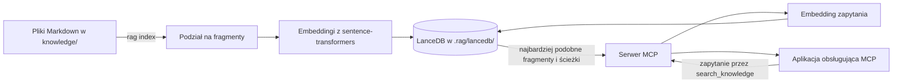

# Lokalny RAG dla aplikacji obsługujących MCP

[](https://github.com/01miru/simple-rag/actions/workflows/tests.yml)

Semantyczne wyszukiwanie w polskich i wielojęzycznych plikach Markdown. Embeddingi i indeks są tworzone lokalnie. Serwer MCP pozwala podłączyć wyszukiwanie do Codexa oraz innych aplikacji i agentów obsługujących MCP.

Polecenia `rag index` i `rag serve` działają z wiersza poleceń. Do indeksowania potrzebny jest katalog `knowledge/`. Serwer MCP udostępnia narzędzie `search_knowledge`, które zwraca fragmenty dokumentów i ich ścieżki. Konfigurację klienta MCP znajdziesz w dokumentacji używanej aplikacji.

## Jak to działa



## Pakiety i baza wektorowa

- LanceDB przechowuje wektory i fragmenty dokumentów w `.rag/lancedb/`. Stan indeksowania plików jest zapisany w `.rag/manifest.json`.
- sentence-transformers tworzy embeddingi za pomocą modelu `paraphrase-multilingual-MiniLM-L12-v2` z Hugging Face.
- PyTorch uruchamia model na CPU albo na karcie NVIDIA obsługującej CUDA.
- FastMCP udostępnia wyszukiwanie przez MCP, korzystając z transportu `stdio`.

Wymienione pakiety instalują się przez `uv sync`. Przy pierwszym użyciu model jest pobierany z Hugging Face, więc potrzebny jest dostęp do internetu i wolne miejsce na dysku.

PyTorch automatycznie wybiera kartę NVIDIA z CUDA, jeśli jest dostępna. W pozostałych przypadkach model działa na CPU.

## Instalacja i indeksowanie

Projekt wymaga Python 3.13 i [uv](https://docs.astral.sh/uv/). W katalogu projektu uruchom:

```sh
uv sync
# Umieść dokumenty .md w knowledge/ (również w podkatalogach).
uv run rag index
```

Po dodaniu, zmianie lub usunięciu dokumentów uruchom ponownie `uv run rag index`. Polecenie aktualizuje w indeksie `.rag/` tylko zmienione pliki i usuwa dokumenty, których już nie ma. Przetwarza treść partiami. Dokumenty muszą być zapisane w UTF-8. Po aktualizacji ze starszej wersji pierwsze uruchomienie przebuduje indeks.

## Podłączenie do Codexa

Codex może połączyć się z serwerem MCP za pomocą poniższego polecenia. Zastąp przykładowe ścieżki bezwzględną ścieżką do projektu:

```sh
codex mcp add lokalna-wiedza -- /ABSOLUTNA/SCIEZKA/DO/rag/.venv/bin/rag serve --directory /ABSOLUTNA/SCIEZKA/DO/rag
```

Sprawdź konfigurację poleceniem `codex mcp list`, a potem uruchom ponownie sesję Codexa. Możesz poprosić na przykład: „Wyszukaj w lokalnej wiedzy informacje o … i podaj źródła”. Narzędzie `search_knowledge` zwraca fragmenty dokumentów i ich ścieżki, z których Codex korzysta przy tworzeniu odpowiedzi. Więcej informacji o konfiguracji MCP znajdziesz w [dokumentacji OpenAI](https://developers.openai.com/codex/mcp/).

Do indeksu i modelu nie potrzebujesz klucza API. Korzystanie z Codexa podlega ustawieniom wybranej usługi Codex.
